# 室内训练机操作手册

> 给现场值班、查阅数据的客户人员使用  
> 软件名称：水质自动监测系统  
> 更新日期：2026-10-12

本手册只写日常怎么用。串口、从站、AI 标定等维护设置由厂家或维护人员操作，文末单独标出，日常不要改。

文中的界面图来自现场正在运行的软件。通信正常时，实时数据的标题和数字是蓝色；下图里若是红色，表示当时通信异常。

---

## 1. 这套软件做什么

软件装在工控机上，用来看水质、启停自动流程、查历史和质控记录。

现场一般有两类数据：

| 数据 | 从哪来 | 看什么 |
| --- | --- | --- |
| **AI 数据** | AI 传感器 | 当前总氮等读数，以及换水后的测量结果 |
| **仪表数据** | 总氮、氨氮、COD、总磷等分析仪 | 分析仪测完后的结果 |

界面上只显示本站已经配置的因子。没有配置的因子不会出现，这是正常现象。

软件有两种运行方式，在「调试」页里选择：

| 模式 | 适合什么时候 | 软件会做什么 |
| --- | --- | --- |
| **训练模式** | 需要分析仪出数，同时让 AI 对照测量 | 先清洗、进样，再静置，然后分析仪测量。进样结束后，AI 在旁边循环换水、静置、测量 |
| **推理模式** | 只需要 AI 连续测 | 不走清洗和仪表测量，只循环做：预排、换水、静置、AI 测量 |

不确定用哪种时，保持现场已经设好的模式，不要自行切换。

---

## 2. 开机、登录和退出

### 2.1 打开软件

1. 打开工控机，确认分析仪、AI、水泵和阀门电源已按现场要求接通。
2. 双击桌面上的系统程序。
3. 软件全屏打开。标题为「水质自动监测系统」。
4. 若本机已配置默认账号，会直接进入主界面，右上角显示当前登录人。
5. 进入后通常已打开「实时数据」和「调试」两个页面，点上方页签切换。

左侧菜单由账号权限决定。看不到某个菜单时，联系管理员开通，不要自行改数据库。

### 2.2 注销和重新登录

1. 点右上角 **注销**。
2. 在提示「是否注销系统?」中选确定。
3. 输入用户名和密码，点登录。
4. 登录失败时，界面提示「登录失败」，核对账号后再试。
5. 点取消会关闭登录窗，需要再点一次注销才能重新登录。

注销只换登录人，**不会停止正在跑的流程**。

点「注销」并确认后，出现登录窗口。密码框保持空白再操作。

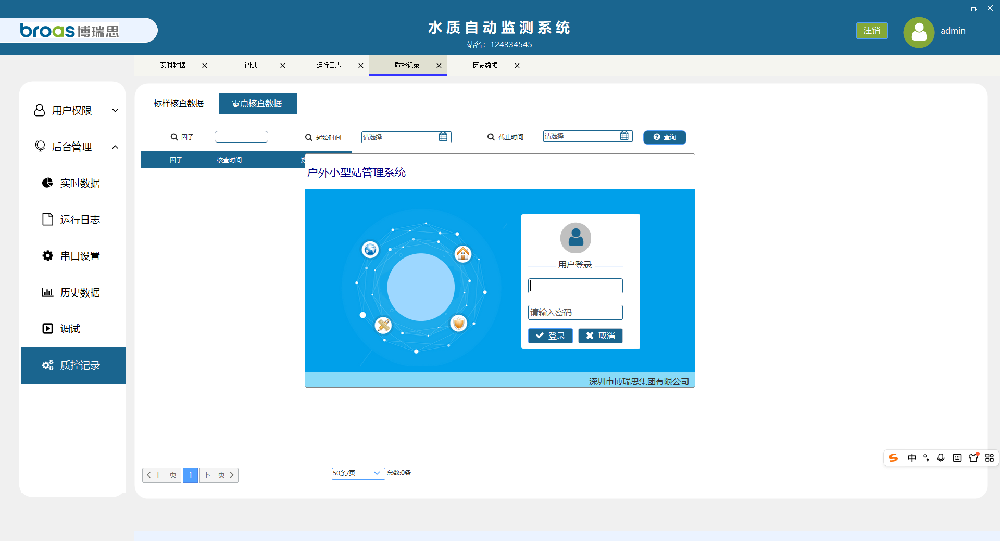

### 2.3 修改密码

1. 点右上角头像。
2. 在「修改密码」里填写新密码，再填一次确认密码。
3. 两次必须一致，长度不超过 8 位。
4. 提示「修改成功」后，下次登录用新密码。

点头像后出现「修改密码」。两个密码框留空，不要把密码拍进去。

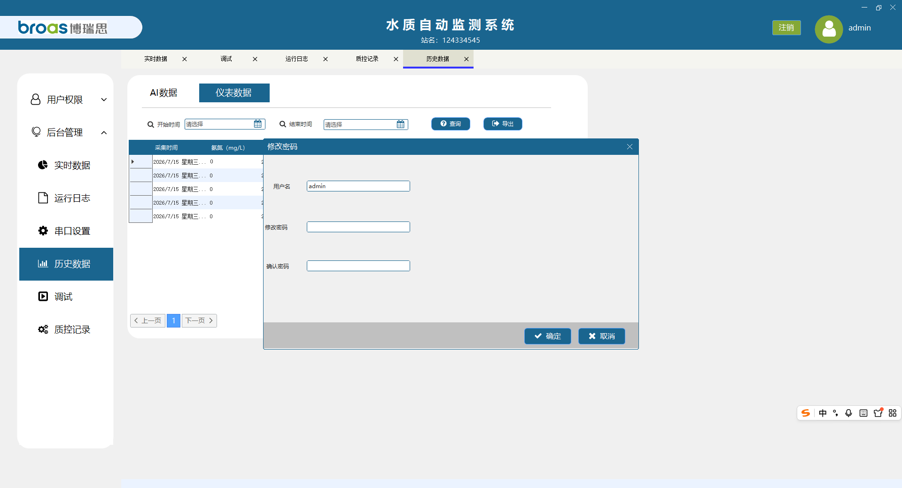

### 2.4 修改站名

标题下方有站名。未设置时显示「站名：双击编辑」。

1. 双击站名。
2. 输入新站名，最多 40 个字，不能为空。
3. 按 **Enter**，或点到别处，保存。
4. 按 **Esc** 放弃本次修改。
5. 提示「站名已保存」后，标题立即换成新站名。

双击站名后，标题处变成输入框。按 Esc 可放弃修改。

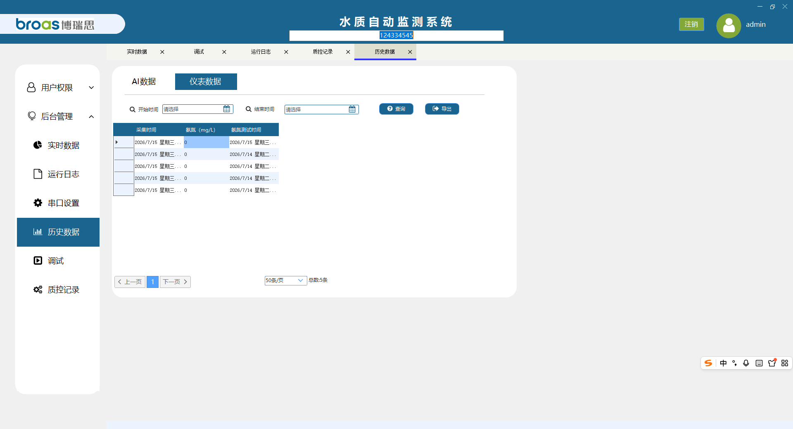

### 2.5 退出软件

点窗口关闭按钮，在「是否退出系统?」中选确定。

退出软件不等于把流程彻底停掉：

- 上次是点「立即启动」跑起来的，或已经到点自动开跑，并且中间没有点「强制结束」：下次打开软件大约 3 秒后会自动再开。
- 只有点过「强制结束」，下次打开才不会自动开。

要停机维护、停水或长时间不用，先到「调试」页点 **强制结束**，确认「当前节点」回到「等待开始」，再退出软件。

---

## 3. 主界面怎么认

主界面包括标题、站名、左侧菜单、已打开的页签，以及右上角的登录人和「注销」。

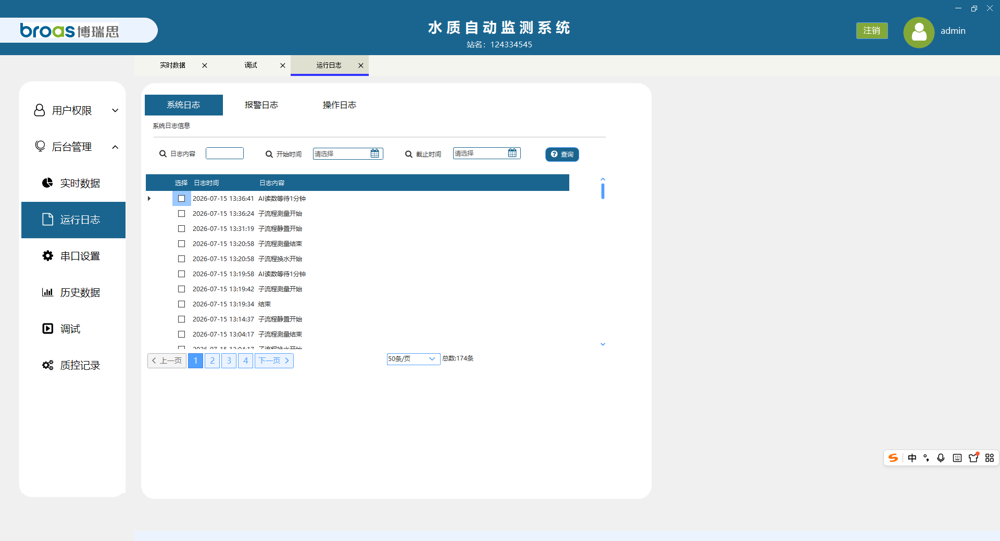

| 位置 | 作用 |
| --- | --- |
| 顶部标题 | 系统名称；下面一行是本站站名 |
| 右上角头像 | 修改当前用户密码 |
| 右上角「注销」 | 换人登录 |
| 当前登录人 | 现在是谁在操作 |
| 左侧菜单 | 按权限进入各功能，点一级菜单展开，再点具体功能 |
| 上方页签 | 已打开的页面。点页签切换；关掉页签即关闭该页 |

没有权限时会提示「您没有此功能权限请联系管理员」，页面不会打开。

---

## 4. 看实时数据

下图是通信异常时的样子：两块卡片的标题和数字都是红色。通信恢复后会变回蓝色。

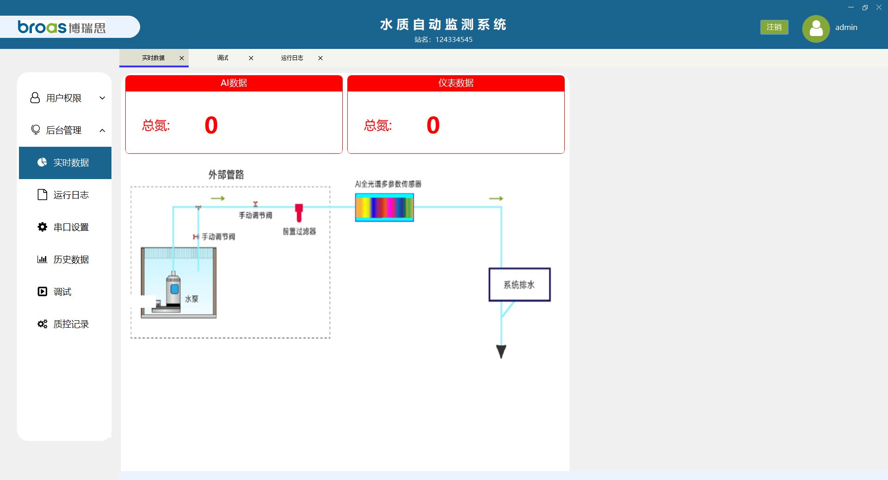

左侧打开 **实时数据**。

页面上方两块大数字：

| 卡片 | 含义 |
| --- | --- |
| **AI 数据** | AI 当前总氮读数，大约每 3 秒刷新 |
| **仪表数据** | 分析仪当前总氮读数，大约每 3 秒刷新 |

数字和标题是蓝色，表示通信正常。变成 **红色**，表示这一侧通信异常：AI 卡片变红是 AI 通信异常，仪表卡片变红是分析仪通信异常。先看线缆、电源和仪表是否开机，仍不恢复就联系维护人员。变红期间不要反复点启动。

页面中部是水路示意图，用来看阀门、水泵的大致位置，例如自来水总阀、泄压阀、自吸泵。示意图只供查看，不在这里开关阀门。

流程图旁若出现报警数字，点一下该数字可清除显示为「1」的提示。清除显示不会消除已经记下的报警，报警仍可在日志里查。

---

## 5. 日常启停（最常用）

打开 **调试**，停留在 **流程控制**。待机时「当前节点」为「等待开始」，运行指示为灰色。

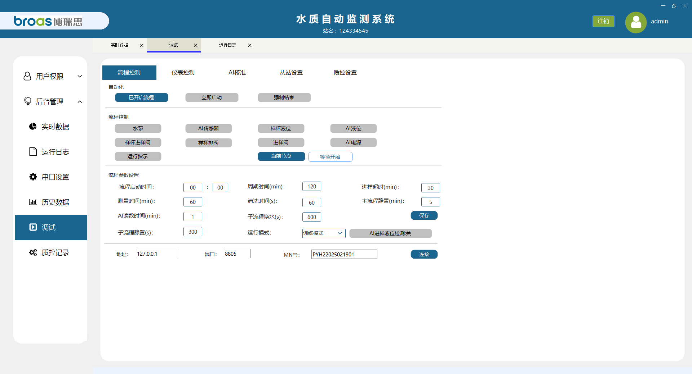

先看两处：

- **当前节点**：现在走到哪一步。空闲时是「等待开始」。
- **运行指示**：亮起表示流程正在跑；灰色表示没在跑。

### 5.1 马上开一轮

1. 确认「运行模式」是现场要求的模式。
2. 需要改时间参数时，先改完并点 **保存**。
3. 点 **立即启动**。
4. 运行指示亮起，「当前节点」离开「等待开始」。
5. 这一轮结束后，按「周期时间」再开下一轮。重新打开软件也会自动接着开，直到有人点「强制结束」。

点下去之后，运行指示变蓝，「当前节点」变成「开始」。

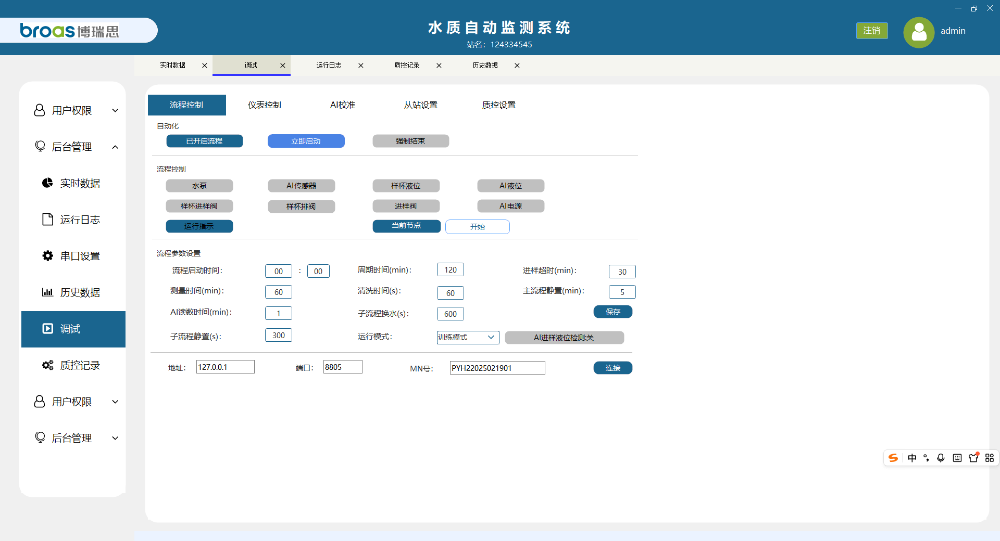

### 5.2 每天到固定时刻再开

1. 在「流程启动时间」里填写小时和分钟，例如 08:00。
2. 点 **开启自动流程**。按钮变成 **已开启流程**，表示到点检查已经打开。
3. 没到这个时刻之前，流程不会跑，运行指示也不会亮。
4. 到点后按当前运行模式开第一轮，之后按「周期时间」重复。
5. 只打开了到点检查、还没到点就关机：下次打开软件 **不会** 自动开跑。
6. 再点一次「已开启流程」，按钮回到「开启自动流程」，到点检查关闭。正在跑的这一轮不会因此马上停，要马上停请点「强制结束」。

按钮变成「已开启流程」后，只表示到点检查已经打开。没到设定时刻时，流程不会跑。

### 5.3 按周期重复

「周期时间」单位是分钟。第一轮开始后，每隔这么多分钟，软件会先停掉上一轮，再开一轮。

周期要大于一轮实际需要的时间。训练模式一轮里包含清洗、进样、静置和仪表测量，设得太短会把还没测完的一轮打断。

「周期时间」在流程参数里，单位是分钟。下图里是 120。改完要点「保存」。

### 5.4 马上停，并且下次不要自动开

1. 点 **强制结束**。
2. 软件停止流程、关掉阀门、让 AI 停止测量。
3. 「当前节点」回到「等待开始」，运行指示熄灭，「已开启流程」也会回到「开启自动流程」。
4. 之后重新打开软件，不会自动再开。

不要用关窗口、注销代替「强制结束」。停完以后，「当前节点」回到「等待开始」，运行指示变灰。

### 5.5 四种启动方式对照

| 你想怎样 | 怎么操作 | 结果 |
| --- | --- | --- |
| 现在就测 | 选好模式，点「立即启动」 | 立刻开跑，并按周期重复；下次开软件会自动再开 |
| 每天固定时刻测 | 填好启动时间，点「开启自动流程」 | 到点才开第一轮；没到点就关机，下次不会自动开 |
| 隔一段时间再测一轮 | 填写「周期时间」后保存 | 上一轮开始后再隔这么多分钟开下一轮 |
| 彻底停下 | 点「强制结束」 | 立刻停。下次开软件不会自动开 |

---

## 6. 运行时会看到什么

点「立即启动」后，运行指示变蓝，「当前节点」离开「等待开始」。下图停在「开始」。

流程跑起来后，阀门由软件自动开关。不要在「流程控制」里手点水泵、样杯进样阀、样杯排阀、进样阀。要单独试阀，先点「强制结束」。

### 6.1 训练模式

「当前节点」依次变化：

**开始 → 清洗 → 进样 → 静置 → 测量 → 结束**

| 节点 | 软件在做什么 | 你需要知道的 |
| --- | --- | --- |
| 开始 | 打开样杯排阀排水，约 10 秒 | 不要手关阀门 |
| 清洗 | 进水冲洗。时长看「清洗时间」，单位秒，常见 60 秒 | 时间到后关掉样杯排阀 |
| 进样 | 等样杯液位。最长等待看「进样超时」，单位分钟，常见 30 分钟 | 超时只记一条报警，**后面照常做**，不会整轮停掉 |
| 静置 | 进样阀关掉后等待。时长看「主流程静置」，单位分钟，常见 5 分钟 | 此时 AI 换水测量已经在旁边开始循环 |
| 测量 | 按现场配置启动总氮、氨氮、COD、总磷等仪表。时长看「测量时间」，单位分钟 | 仪表没起来只记报警，到时间仍会保存数据 |
| 结束 | 关掉还开着的阀门 | 旁边的 AI 循环一起停 |

训练模式是两条线同时走：主流程测分析仪，AI 在旁边自己换水、静置、测量。点「强制结束」或本轮结束，两边一起停。

运行中看「当前节点」就知道走到哪一步。下面是清洗、进样、静置、测量时的画面。运行指示保持蓝色。「结束」只有大约 10 秒，阀门关掉后回到「等待开始」。

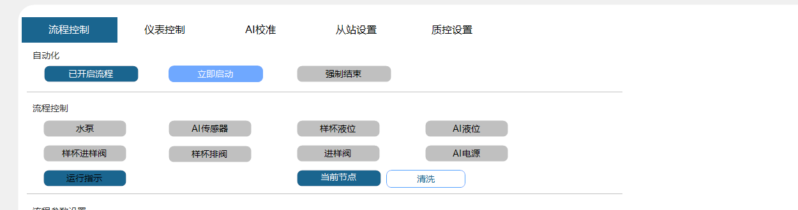

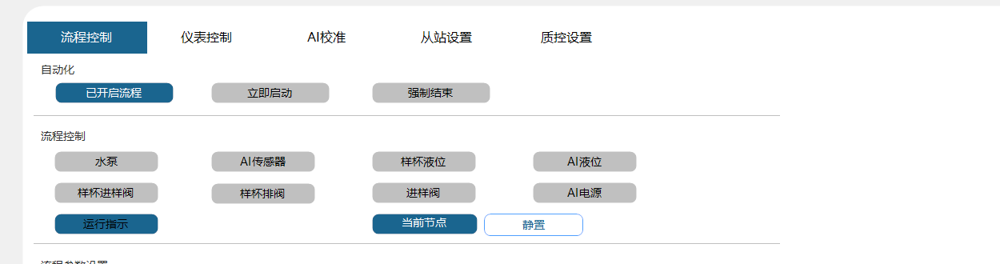

### 6.2 推理模式

不出现清洗、进样、仪表测量这些节点。运行指示亮起后，只反复做：预排、换水、静置、AI 测量，直到点「强制结束」或到了下一周期。

预排时会打开样杯进样阀和样杯排阀，看着 AI 液位。连续大约 10 秒都没有液位，才关阀并开始换水。这时「当前节点」显示「预排」，运行模式是「推理模式」。

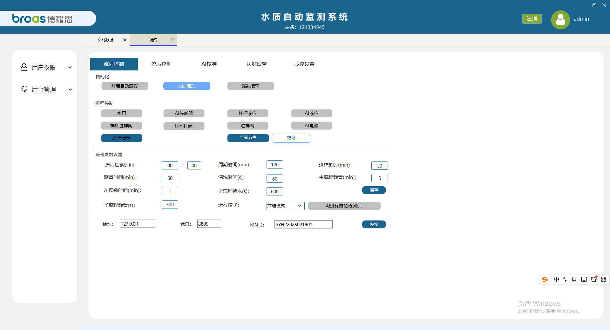

### 6.3 AI 每一轮在做什么

| 步骤 | 时长在哪改 | 常见默认 | 做什么 |
| --- | --- | --- | --- |
| 换水 | 子流程换水，单位秒 | 600 秒 | 打开进样阀和水泵 |
| 静置 | 子流程静置，单位秒 | 300 秒 | 关掉进样阀和水泵，等待 |
| 测量 | AI 读数时间，单位分钟 | 1 分钟 | AI 进入测量后再等这段时间，然后停止，进入下一轮 |

「AI进样液位检测」按钮点一下就切换，改完建议再点「保存」：

- **关**（常见默认）：不看 AI 液位，直接让 AI 测量。
- **开**：必须看到 AI 液位才发测量。没有液位会记「AI液位信号丢失」，等几秒再看，最多试若干次。试完仍会进入下一轮，不会把整个流程卡死。

两个液位不要混：

- **样杯液位**：只判断训练模式进样时样杯满没满。
- **AI 液位**：判断推理模式预排是否排空；液位检测打开时，还用来决定能不能发 AI 测量。

---

## 7. 流程参数怎么改

都在「调试 → 流程控制 → 流程参数设置」。改完必须点 **保存**。只改数字不保存，下次打开会回到原值。

流程正在跑时不要改模式和关键时间。要改，先点「强制结束」，改完保存，再重新启动。

| 界面名称 | 单位 | 作用 | 常见默认 |
| --- | --- | --- | --- |
| 流程启动时间 | 时:分 | 「已开启流程」后，每天这个时刻开第一轮 | 按现场填写 |
| 周期时间 | 分钟 | 两轮间隔 | 120 |
| 进样超时 | 分钟 | 训练模式等样杯液位最多等多久 | 30 |
| 测量时间 | 分钟 | 训练模式仪表测量等多久 | 以界面当前值为准 |
| 清洗时间 | 秒 | 训练模式清洗多久 | 60 |
| 主流程静置 | 分钟 | 训练模式进样后静置多久 | 5 |
| 子流程换水 | 秒 | AI 换水多久 | 600 |
| 子流程静置 | 秒 | AI 换水后静置多久 | 300 |
| AI 读数时间 | 分钟 | AI 进入测量后再等多久 | 1 |
| 运行模式 | — | 训练模式 / 推理模式 | 训练模式 |
| AI进样液位检测 | — | 开：没液位不测量；关：不看液位直接测 | 关 |

时间只能填数字。小时用 24 小时制，分钟为 00 到 59。

参数、运行模式、液位检测和「保存」都在「流程控制」这一页的下半部分。下图中的数字是截图当时界面上的值。

同一页还有「上传设置」（MN 号、地址、端口、连接）。这是往平台传数用的，现场已经调通就不要改。MN 号一改会立刻保存。

---

## 8. 查历史数据并导出

左侧打开历史数据（数据采集）页面。有两个页签。

### 8.1 AI 数据

1. 选类型：
   - **分钟**：按分钟采集的 AI 数据，可以看吸光度曲线。
   - **周期**：每一轮流程对应的 AI 数据，不能看曲线。
2. 填写开始时间、结束时间。两个时间都空着，表示不按时间限制。
3. 点 **查询**。改了时间或类型后，必须再点一次查询，只翻页不会用新条件。
4. 用底部分页翻页。默认每页 50 条。
5. 点 **导出**，选择保存位置。导出的是当前查询条件下的全部记录，不限当前这一页。成功后可选「是否立即打开」。

列表里常见列：采集时间，以及本站配置的总氮、氨氮、COD、总磷。单位 mg/L。

「AI数据」页要能看到类型（分钟或周期）、起止时间、「查询」「导出」和数据表。

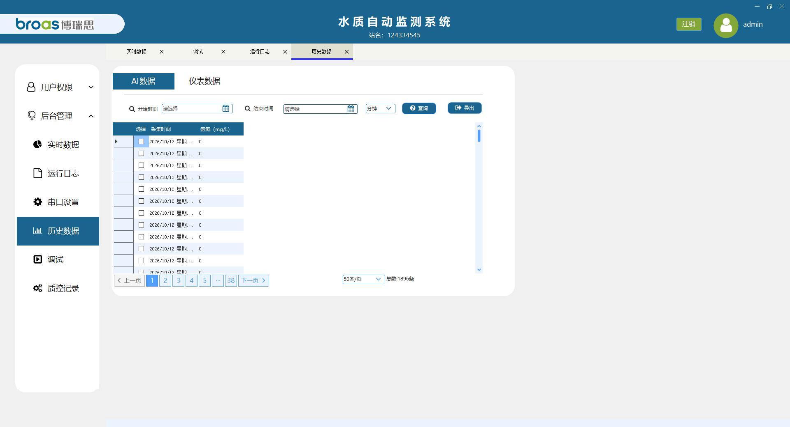

看吸光度曲线：

1. 类型必须是 **分钟**。
2. 双击某一行（不要双击最左侧选择列）。
3. 弹出「吸光度曲线」，标题带该行采集时间。
4. 若类型是「周期」，会提示先切换到「分钟」。

该分钟如果存有吸光度记录，会弹出曲线窗口。没有记录时，只出现一条提示，不会打开曲线。下图就是没有光谱数据时的提示。

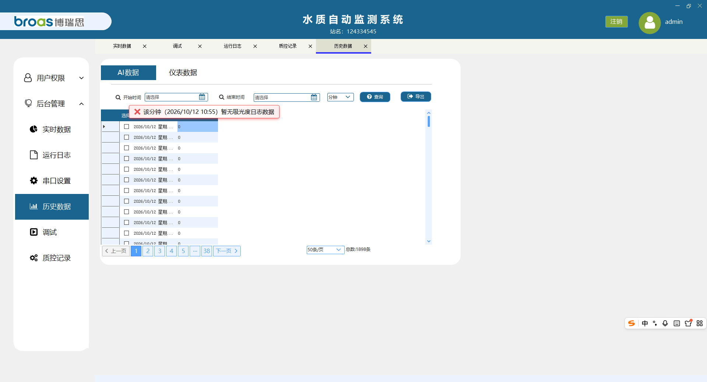

### 8.2 仪表数据

1. 填写开始时间、结束时间。
2. 点 **查询**。
3. 列表含采集时间、各因子浓度，以及总氮、氨氮、COD、总磷各自的测试时间。
4. 点 **导出**，同样导出当前条件下的全部记录。

「仪表数据」页除了浓度，还有各因子自己的测试时间。

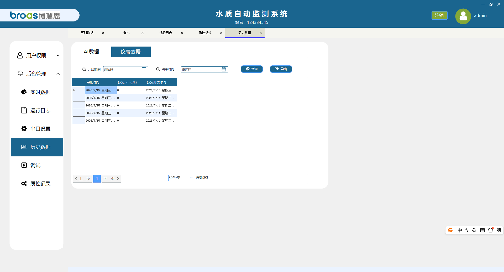

查不到数据时，先放宽时间范围再查。仍没有，说明该时段没有保存成功，到日志里看有没有报警。

---

## 9. 查质控记录

左侧 **后台管理 → 质控记录**。

| 页签 | 内容 |
| --- | --- |
| 标样核查数据 | 标样（标液）核查结果 |
| 零点核查数据 | 零点核查结果 |

打开页面就会列出最新记录，新的在上面。

查询步骤：

1. 可选填因子名称。
2. 填写起始时间、截止时间。不填表示不限制。
3. 点 **查询**。改条件后必须再点查询，只翻页仍用上一次的条件。
4. 每页 50 条，用底部分页查看。

列表列：因子、核查时间、数值。

这里只查已经保存的结果，不会向仪表重新发核查，也不会重新判断合格不合格。

还没有核查记录时，表格是空的，查询条件那一排仍然要能看到。

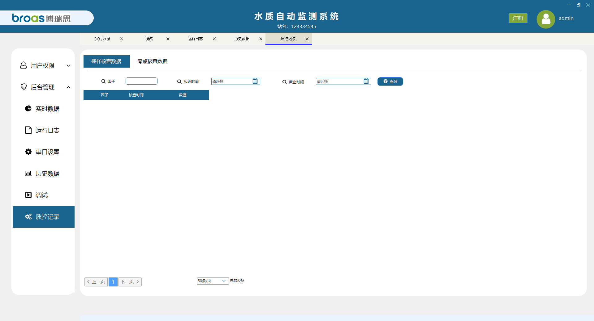

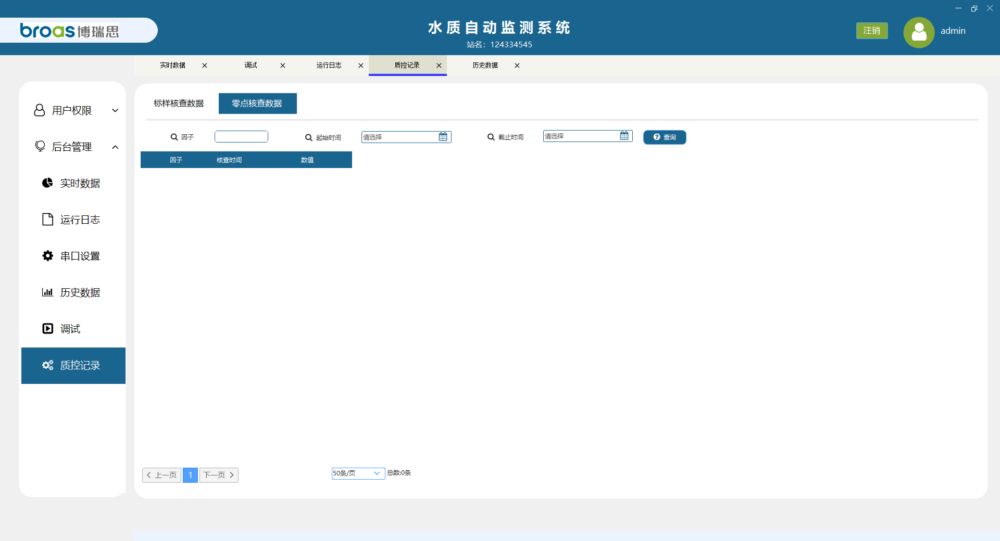

---

## 10. 设置仪表自动核查

在 **调试 → 质控设置 → 仪表质控**。只显示本站已配置的因子，每个因子有「零点核查」和「标样核查」两行。

每一行：

| 填写项 | 怎么填 |
| --- | --- |
| 周期 | 三位，用冒号隔开。第一位：`00` 表示每天，`0` 表示周日，`1` 到 `6` 表示周一到周六。后面是小时和分钟 |
| 核查浓度 | 按标准溶液的实际浓度填写 |
| 开关 | 按钮显示「开启」表示目前是关的，点一下变成「已开启」才会计时。开关一点就保存 |
| 保存配置 | 改完周期或浓度后要点这个按钮 |

举例：每天 08:30 做标样核查，周期填 `00:08:30`，填好浓度，点「保存配置」，再把开关点成「已开启」。

到点后软件自动向对应分析仪发核查。结果到「质控记录」里查看。

不要把零点核查和标样核查设成同一分钟。改时间前先确认分析仪处于空闲，避免和正在进行的测量抢在一起。

本站只配置了氨氮，所以页面上只有氨氮的零点核查和标样核查。按钮显示「开启」表示目前是关的。

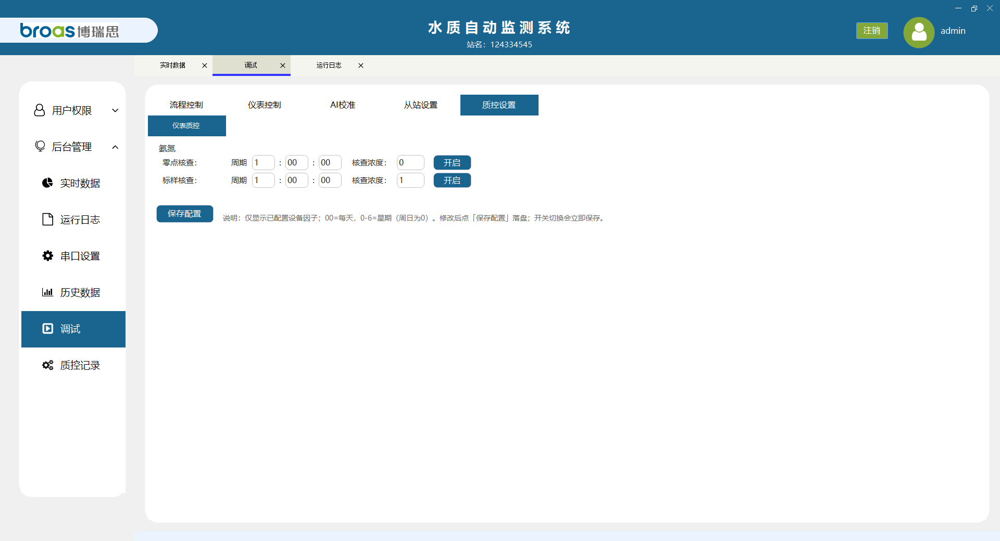

---

## 11. 手动操作分析仪

在 **调试 → 仪表控制**。总氮、氨氮、COD、总磷各有一块，只显示本站配置的仪器。

每块仪器上先看：

| 显示 | 含义 |
| --- | --- |
| 工作状态 | 空闲、测量、核查等。不是空闲时，不要再发启动、标定、核查 |
| 报警状态 | 「正常」以外都要先看日志，必要时联系维护 |
| 仪器时间 | 和工控机时间差很多时，再做时间校准 |

日常可能用到的按钮：

| 按钮 | 作用 | 注意 |
| --- | --- | --- |
| 启动测量 | 让这台仪器马上测一次 | 确认试剂、水样和水路正常，且工作状态为空闲 |
| 停止测试 | 停止当前测试 | 只停这一台，不会代替「强制结束」 |
| 清洗 | 按仪器程序清洗 | 清洗期间不要再点启动 |
| 时间校准 | 把仪器时间校到当前时间 | 仪器空闲时操作 |
| 标样核查 | 马上做一次标样核查 | 标准溶液和浓度要已经按要求准备好 |
| 零点核查 | 马上做一次零点核查 | 同上 |
| 跨度核查 | 马上做一次跨度核查 | 同上 |
| 平行样测试 | 做平行样 | 按仪器和现场规程 |

下面这些会改变仪器曲线或让仪器重启，**没有维护人员在场不要点**：

- 标定、零点校准、量标校准
- 重启仪器

点下去会立刻发给仪器，没有二次确认。点错后到该仪器的「工作状态」确认它在做什么，并在操作日志里能查到记录。

本站仪表控制页目前只有氨氮。先看工作状态和报警状态，不要随手点标定或重启。

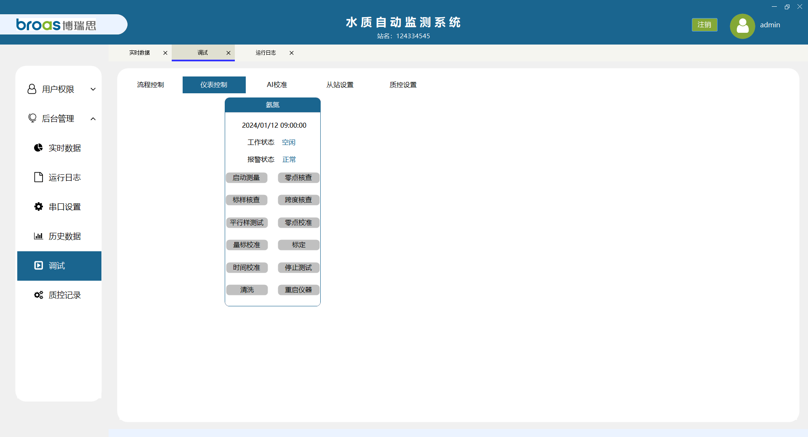

---

## 12. 查日志

日志页面一般有三个页签：

| 页签 | 用来查什么 |
| --- | --- |
| 系统日志 | 软件运行记录 |
| 报警日志 | 进样超时、通信失败、液位丢失等 |
| 操作日志 | 谁在什么时间做了启动、强制结束、停止测量等操作 |

查询步骤：

1. 选开始时间和截止时间。
2. 日志内容可填关键字，例如「进样超时」「强制结束」。
3. 点 **查询**。
4. 用分页往后翻。报警和系统日志能看到创建人、时间、来源和内容；操作日志能看到时间和内容。

出现异常时，先记一下「当前节点」、哪一张卡片变红、报警原文，再联系维护。不要先重启工控机，否则现场状态会被清掉。

---

## 13. 这些页面日常不要动

| 页面 | 原因 |
| --- | --- |
| 调试 → AI 校准 | 标定系数会改变 AI 读数，只由维护人员在标准溶液下操作 |
| 调试 → 从站设置 | 网口、串口从站是给上位机或平台读数用的，改端口或站号会导致对方读不到数 |
| 流程运行中的阀门按钮 | 和水路自动动作冲突，可能排空、溢流或让测量失败 |
| 用户、角色、权限 | 由管理员维护。普通值班人员只改自己的密码 |

---

## 14. 常见情况

| 现象 | 先做这些 |
| --- | --- |
| 点了「开启自动流程」，流程没动 | 看是不是还没到「流程启动时间」。按钮显示「已开启流程」只表示到点检查开了 |
| 关过软件，一打开又自己跑 | 上次没有点「强制结束」。要停就先强制结束 |
| 关过软件，没有自己跑 | 上次点过「强制结束」，或只打开了到点检查但还没到点。需要现在测就点「立即启动」 |
| 当前节点停在「进样」很久 | 看样杯液位。等到「进样超时」会记报警，然后仍会继续后面的步骤 |
| AI 数据或仪表数据变红 | 通信异常。检查对应设备电源和连线，查报警日志 |
| 进样超时或仪表没启动 | 流程不会卡死，数据仍可能保存。到报警日志核对，再决定要不要重跑 |
| 历史查询是空的 | 放宽时间，确认页签是 AI 还是仪表，改条件后重新点「查询」 |
| 双击 AI 记录没有曲线 | 类型要选「分钟」。「周期」数据没有曲线 |
| 改了筛选条件，翻页还是旧数据 | 先点「查询」，再翻页 |
| 菜单里没有质控或历史 | 当前账号没有权限，联系管理员 |
| 要停水、换试剂、维护 | 先「强制结束」，确认节点为「等待开始」、阀门已关，再动水路 |

---

## 15. 操作时请遵守

1. 启动前确认水源、试剂、废液和各仪器电源正常。
2. 流程运行中不要手点阀门，不要关软件窗口来“暂停”。
3. 改参数后要点「保存」。改模式、改周期前先强制结束。
4. 要让下次开机不再自动跑，必须点「强制结束」。
5. 标定、校准、重启仪器、AI 标定、从站和上传地址，没有维护说明不要改。
6. 导出数据前先查对时间范围。导出文件用 Excel 打开，妥善保存，不要只留在临时目录。
7. 密码不要告诉无关人员。离职或换班需要收权限时，由管理员处理账号。
8. 报警先记录再处理。清除实时页面上的报警数字，不会删除日志。
