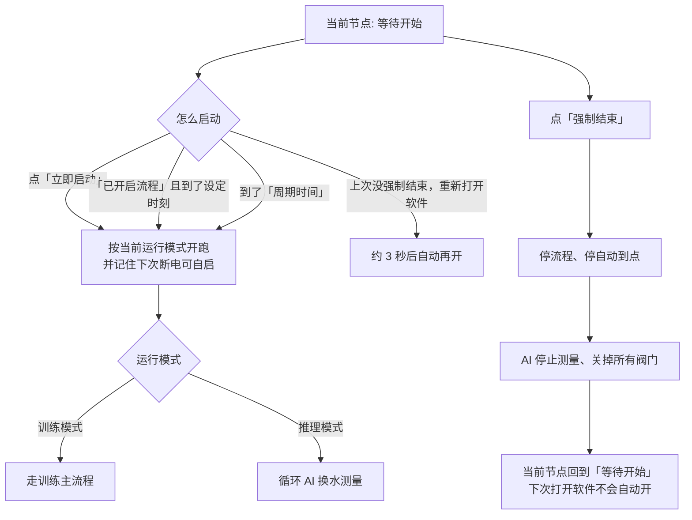
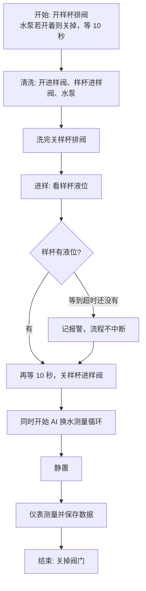
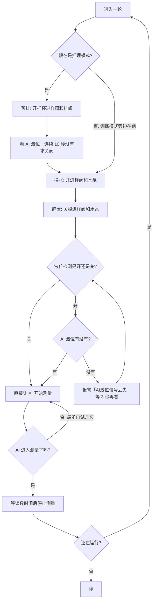

# 室内训练机（大亚湾）操作流程说明

> 给现场操作、调试人员看  
> 更新日期：2026-10-12

---

## 1. 两种运行模式

在调试页「运行模式」里切换，改完后点「保存」。

| 模式 | 做什么 |
| --- | --- |
| **训练模式** | 走完整主流程：开始 → 清洗 → 进样 → 静置 → 仪表测量 → 结束。进样完成后，AI 换水测量会同时在旁边循环跑。 |
| **推理模式** | 不走上面的主流程，只循环做：预排 → 换水 → 静置 → AI 测量。 |

界面「当前节点」会显示走到哪一步；「运行指示」亮起表示流程在跑。运行模式在「流程参数设置」里，见第 8 节的界面图。

---

## 2. 阀门和液位（调试页上的按钮）

| 界面名称 | 干什么 |
| --- | --- |
| 水泵 | 清洗、AI 换水时抽水 |
| 样杯进样阀 | 清洗、进样、推理预排时给样杯进水 |
| 样杯排阀 | 开始时排空样杯；推理模式换水前预排 |
| 进样阀 | 清洗、AI 换水时给水路进水 |
| 样杯液位 | 训练模式进样时判断样杯满没满 |
| AI 液位 | 推理预排时判断排空了没有；「液位检测:开」时还用来决定能不能发 AI 测量 |

流程跑起来后，这些阀门由程序自动开关，一般不用手点。手点只适合单独调试。

待机时「当前节点」是「等待开始」，运行指示为灰色。水泵、样杯进样阀、样杯排阀、进样阀、样杯液位、AI 液位都在这一页。

---

## 3. 流程图

### 3.1 怎么启动、怎么停

待机时节点是「等待开始」。点「立即启动」后运行指示变蓝，节点变成「开始」。

### 3.2 训练模式

界面上「当前节点」会跟着这几步变化。运行指示在整轮里保持亮起。

### 3.3 AI 换水测量（含液位检测）

推理模式刚启动时，当前节点是「预排」，运行模式显示「推理模式」。

---

## 4. 怎么启动、怎么停

下图是还没跑起来的样子：当前节点「等待开始」，「已开启流程」表示到点检查已经打开。

| 做法 | 在界面上怎么操作 | 结果 |
| --- | --- | --- |
| 马上开一轮 | 选好运行模式，点「立即启动」 | 立刻按当前模式开跑，并按「周期时间」之后再跑下一轮。重新打开软件后也会自动接着开。 |
| 每天到点再开 | 填好「流程启动时间」，点「已开启流程」 | 到了设定的时、分才开第一轮，之后按周期重复。只开了这个、还没到点，断电后不会自动开。 |
| 按周期重复 | 填「周期时间」（分钟） | 第一轮开始后，每隔这么多分钟再开一轮（会先停掉上一轮）。 |
| 断电后再开软件 | 不用操作 | 如果上次是「立即启动」或已经到点开跑、且中间没点「强制结束」，大约 3 秒后自动再开。 |
| 马上停 | 点「强制结束」 | 立刻停、关阀门、停 AI 测量。「当前节点」回到「等待开始」。重新打开软件不会自动开。 |

「开启自动流程 / 已开启流程」只是打开「到点检查」。不到点不会开跑。按钮变成「已开启流程」时，上图左侧那个蓝按钮就是这个状态。

点「立即启动」后，运行指示变蓝，「当前节点」离开「等待开始」。下图停在「开始」。

---

## 5. 训练模式各阶段

「当前节点」会依次变成：开始 → 清洗 → 进样 → 静置 → 测量 → 结束。

### 5.1 开始

1. 打开样杯排阀  
2. 水泵如果开着，先关掉  
3. 等 10 秒  

### 5.2 清洗

时长看界面「清洗时间」，单位是秒，默认 60 秒。

1. 打开进样阀  
2. 打开样杯进样阀  
3. 打开水泵  
4. 前一半时间里，哪个阀掉了会再打开  
5. 时间到了，关掉样杯排阀  

### 5.3 进样

最长等待看「进样超时」，单位是分钟，默认 30 分钟。

1. 不停看样杯液位  
2. 等到超时还没有液位：记一条「进样超时」报警，**后面步骤照常做**  
3. 有液位（或已经超时）后再等 10 秒  
4. 关掉样杯进样阀  
5. **同时**开始旁边的 AI 换水测量循环  

### 5.4 静置

时长看「主流程静置」，单位是分钟，默认 5 分钟。确认样杯进样阀已关，然后等待。

### 5.5 测量

时长看「测量时间」，单位是分钟，默认 60 分钟。

按现场配置依次启动总氮、氨氮、COD、总磷等仪表，最多试 3 次。时间到了保存本轮仪表数据。仪表没起来只记报警，数据仍会存。

### 5.6 结束

关掉还开着的阀门，本轮主流程结束。旁边的 AI 循环也会跟着停。

---

## 6. 推理模式

不走清洗、进样、仪表测量这条主流程。运行指示亮起后，只循环做第 7 节的 AI 换水测量，直到点「强制结束」或到了下一周期。

每一轮换水前会先 **预排**：打开样杯进样阀和样杯排阀，看着 AI 液位；**连续 10 秒都没有液位**才关阀，然后进入换水。预排时「当前节点」显示「预排」。

---

## 7. AI 换水 — 静置 — 测量

训练模式里，进样关阀后开始循环，和主流程的静置、仪表测量同时进行。  
推理模式里，这就是全部工作。

### 7.1 换水

时长看「子流程换水」，单位是秒，默认 600 秒。打开进样阀和水泵，等到时间。

### 7.2 静置

时长看「子流程静置」，单位是秒，默认 300 秒。关掉进样阀和水泵，等到时间。

### 7.3 测量

看界面「AI进样液位检测:开 / AI进样液位检测:关」（点一下就切换，改完建议点「保存」）：

- **关（默认）**：不管 AI 液位，直接让 AI 开始测量。  
- **开**：必须看到 AI 液位才发测量。没有液位会报「AI液位信号丢失」，等 3 秒再看。最多试 5 次。  

AI 进入测量后，再等「AI 读数时间」（分钟，默认 1），然后停止测量，进入下一轮。  
5 次都没进去：记报警，仍然等读数时间后停测，再进入下一轮（流程还在的话）。

---

## 8. 界面参数

| 界面名称 | 单位 | 做什么 | 常见默认 |
| --- | --- | --- | --- |
| 流程启动时间 | 时:分 | 点了「已开启流程」后，每天这个时刻开第一轮 | 按现场设定 |
| 周期时间 | 分钟 | 两轮之间隔多久 | 按现场设定 |
| 进样超时 | 分钟 | 训练模式等样杯液位最多等多久 | 30 |
| 测量时间 | 分钟 | 训练模式仪表测量等多久 | 60 |
| 清洗时间 | 秒 | 训练模式清洗多久 | 60 |
| 主流程静置 | 分钟 | 训练模式进样后静置多久 | 5 |
| 子流程换水 | 秒 | AI 换水多久 | 600 |
| 子流程静置 | 秒 | AI 换水后静置多久 | 300 |
| AI 读数时间 | 分钟 | AI 进入测量后再等多久读数 | 1 |
| 运行模式 | — | 训练模式 / 推理模式 | 训练模式 |
| 液位检测 | — | 开：没 AI 液位不测量；关：不看液位直接测 | 关 |

改完点「保存」。下图是现场界面上的当前值，包括运行模式和「AI进样液位检测」。

---

## 9. 操作注意

1. **两个液位不要搞混**：样杯液位只管训练进样满没满；AI 液位管推理预排空没空，以及「液位检测:开」时能不能测。  
2. **训练模式是两条线一起走**：进样结束后，主流程继续静置、测仪表；AI 自己在旁边换水、静置、测量。点「强制结束」或本轮结束，两边一起停。  
3. **进样超时不会停整轮**：只记报警，照样关阀、开 AI 循环、做后面的静置和测量。  
4. **测量失败也不会卡死**：AI 最多试 5 次，仪表最多试 3 次，失败只报警，后面的等待和存数照做。  
5. **要彻底停、并且下次打开软件不要自动开**：必须点「强制结束」，不要只关窗口。  
6. **手点阀门**：流程正在跑时不要手点阀门，容易和自动动作打架。单独试阀请先强制结束。  
